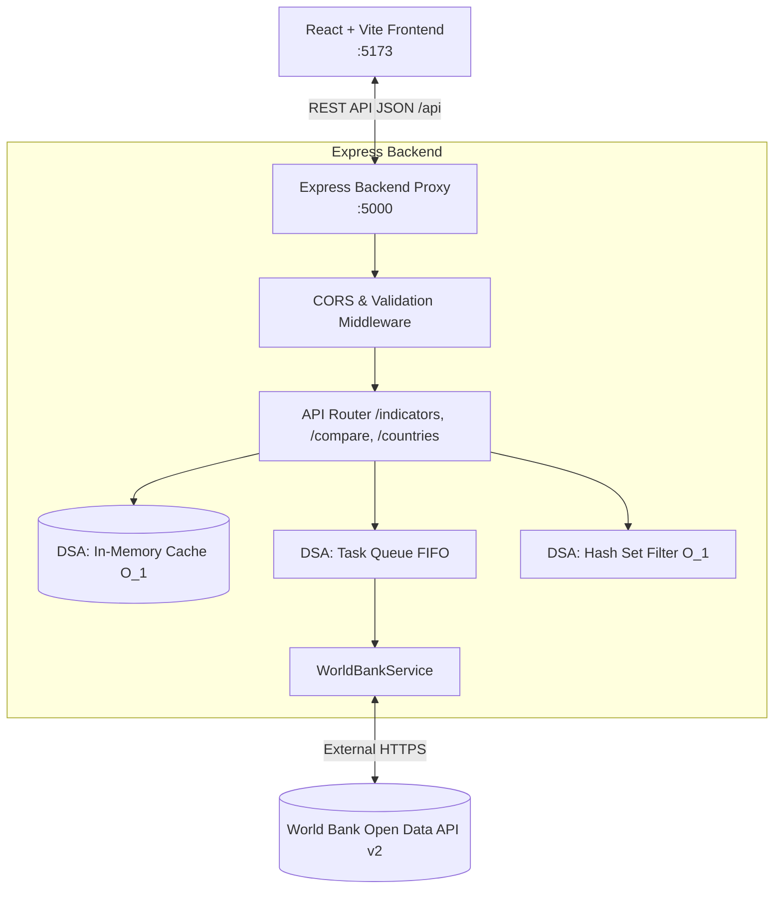

# 🌐 ZoneZet Version 2 · World Bank Economic Dashboard & Comparison Hub

> **วิชา 801201:** การออกแบบอัลกอริทึมและการพัฒนาเว็บ (Algorithm Design and Web Development)  
> **ใบงาน:** ต่อยอดงาน API ด้วย React-Vite + Express  
> **คะแนนเต็ม:** 15 คะแนน | **รูปแบบ:** กลุ่ม 2 คน  

---

## 📌 7. แบบตารางตามข้อกำหนดใบงาน

### 7.1 ตารางส่วนร่วม (Contribution Table)

| ชื่อ-สกุล | รหัสนักศึกษา | ชิ้นงานที่รับผิดชอบ (ไฟล์ / Component / Route / DSA) | ช่วงที่นำเสนอในคลิป |
|---|:---:|---|:---:|
| **นาย อภิรักษ์ ถนอมวงษ์** | 681310025 | **Frontend & UX Lead:**<br>• `frontend/src/App.jsx`<br>• `frontend/src/components/ComparisonHub.jsx`<br>• `frontend/src/components/IndicatorView.jsx`<br>• `frontend/src/components/DashboardHome.jsx`<br>• `frontend/src/components/FeedbackStates.jsx`<br>• `frontend/src/utils/dsa/mergeSort.js`<br>• `frontend/src/utils/dsa/undoStack.js` | **ช่วงที่ 1, 2, 3**<br>(0:00 – 3:30)<br>• เปิดคลิป & ตารางส่วนร่วม<br>• Before → After ด้าน UX/UI<br>• Demo ระบบจริง & Compare Hub |
| **นาย อนุพงษ์ [นามสกุล]** | [รหัสนักศึกษา] | **Backend & DSA Lead:**<br>• `backend/server.js`<br>• `backend/routes/indicatorRoutes.js`<br>• `backend/routes/comparisonRoutes.js`<br>• `backend/services/worldBankService.js`<br>• `backend/utils/dsaCache.js`<br>• `backend/utils/dsaQueue.js`<br>• `backend/utils/validation.js` | **ช่วงที่ 4, 5, 6**<br>(3:30 – 7:00)<br>• เบื้องหลังระบบ React ↔ Express<br>• หน้าที่ Express (Proxy, Cache, Validate)<br>• DSA เชิงลึก (Big-O & เปรียบเทียบ)<br>• สรุปผล & Q&A |

*(หมายเหตุ: สมาชิกทั้ง 2 คนมีเวลาพูดคนละเกิน 2 นาทีตามเกณฑ์กลุ่ม 2 คน)*

---

### 7.2 ตารางข้อแนะนำจากงานแรก → สิ่งที่แก้ (Before → After Evidence)

| ข้อแนะนำจากงานแรก | สิ่งที่แก้ในงานนี้ (Version 2) | หลักฐาน Before → After |
|---|---|---|
| **1. "อยากให้ดูง่ายกว่านี้ มี UX/UI ที่ดีกว่านี้"** | ปรับสถาปัตยกรรมเป็น **Single Page Application (SPA)** ด้วย React-Vite ตกแต่งด้วยธีม Modern Fintech Dashboard มีโครงสร้างเมนูและฟิลเตอร์ภูมิภาคชัดเจน ไม่ต้องกดเปลี่ยนหน้า HTML ไปมาเหมือนเดิม | **Before:** แยกหน้า `gdp.html`, `inflation.html`, `unemployment.html` ดีไซน์ตารางแบบเรียบ ไม่มี Visual Guidance<br>**After:** รวมศูนย์หน้าเดียว สลับแท็บได้ในคลิกเดียว พร้อม Interactive Cards และสถานะ Loading Skeleton |
| **2. "อยากให้มีกราฟ"** | ติดตั้งและพัฒนา Interactive Visualization ด้วย **Recharts** ทั้ง Bar Chart สัดส่วนในหน้า Home, แท่งอันดับในหน้าตัวชี้วัด และ Multi-Line Chart เทรนด์ย้อนหลัง 5 ปี (2020–2025) | **Before:** มีเพียงรูปภาพนิ่งใน Carousel สไลด์ ไม่สามารถตอบสนองหรือแสดงข้อมูลจริงตามฟิลเตอร์ได้<br>**After:** กราฟ SVG แบบ Dynamic ตอบสนองตามตัวกรองปีและประเทศ มี Tooltip แสดงตัวเลขจริงทันทีเมื่อ Hover |
| **3. "ชูเรื่องฟีเจอร์การเปรียบเทียบและให้ใช้งานได้จริง"** | สร้าง **Comparison Hub** ที่ผู้ใช้สามารถเลือก 2–5 ประเทศมาวางเทียบกันแบบ Head-to-Head ทั้งเส้นกราฟเปรียบเทียบ GDP/เงินเฟ้อ/ว่างงาน และการ์ดสรุป Matrix สถิติด้านล่าง พร้อมพรีเซ็ตกลุ่มประเทศ (เช่น อาเซียน, มหาอำนาจโลก) | **Before:** มีเพียง Modal เปรียบเทียบแบบง่ายใน V.1 ซึ่งเปรียบเทียบได้จำกัดและดูยาก<br>**After:** ศูนย์เปรียบเทียบเต็มรูปแบบ วิเคราะห์ตัวเลขข้ามประเทศได้ลึกขึ้น มีระบบแท็กชิปและพรีเซ็ตคลิกเดียว |
| **4. "สถานะการทำงาน (Feedback) และ Forgiveness"** | เพิ่มสถานะครบ 4 มิติ: **Loading** (Skeleton Animation), **Empty** (แนะนำคำค้นหา), **Error** (Fallback Safe Guard), **Success** และระบบ **Undo Stack (LIFO)** กู้คืนรายการที่เผลอลบ | **Before:** หากดึง API ไม่สำเร็จหน้าจอจะค้าง หากลบข้อมูลในบันทึกต้องกดค้นหาใหม่<br>**After:** มี Banner แจ้งเตือนข้อผิดพลาดพร้อมปุ่ม Retry และปุ่ม Undo กู้คืนข้อมูลทันที |

---

## 🏗️ 2. สถาปัตยกรรมระบบ (System Architecture & Component Tree)



### Component Tree (Frontend React)

```
App.jsx (Root State: activeTab, selectedYear, searchQuery, comparedList, watchlist)
├── Sidebar.jsx (Brand, Navigation Links, Badge Counters)
├── Header.jsx (Search Input, Year Dropdown, Cache Stats Pill, Compare Shortcut)
├── UndoToast.jsx (Floating Notification with Stack Rollback)
└── Content Area:
    ├── DashboardHome.jsx
    │   ├── Feature Spotlight Banner
    │   ├── MetricCard.jsx (GDP TOP 5)
    │   ├── MetricCard.jsx (Inflation TOP 5)
    │   ├── MetricCard.jsx (Unemployment TOP 5)
    │   └── Recharts Bar Overview (Top Performers)
    ├── IndicatorView.jsx (GDP / Inflation / Unemployment)
    │   ├── RegionFilterPills
    │   ├── Recharts Top 10 Chart
    │   ├── SortToolbar (MergeSort O(n log n))
    │   └── ModernTable (Country Rows, Badges, Compare/Pin Actions)
    ├── ComparisonHub.jsx (Flagship Feature)
    │   ├── PresetSelector (ASEAN, G4, East Asia)
    │   ├── CountryChipSelector (Search Dropdown)
    │   ├── MetricToggle (GDP, Inflation, Unemployment)
    │   ├── Recharts Multi-Line Comparison Chart (2020-2025)
    │   └── Side-by-Side Comparison Matrix Cards
    ├── WatchlistRecordView.jsx
    │   ├── Pinned Countries Table
    │   ├── Undo/Rollback Action (Stack LIFO)
    │   └── Batch Send to Compare Hub
    └── FeedbackStates.jsx (LoadingSkeleton, EmptyState, ErrorBanner)
```

---

## ⚡ 3. การประยุกต์ใช้โครงสร้างข้อมูลและอัลกอริทึม (DSA Deep Dive)

| โครงสร้าง / อัลกอริทึม | ตำแหน่งที่อยู่ | ผลต่อ UX / เหตุผลที่เลือก | การวิเคราะห์เชิงลึก (Big-O / เปรียบเทียบ) |
|---|:---:|---|---|
| **1. Merge Sort** | **React Frontend** (`utils/dsa/mergeSort.js`) | ผู้ใช้สามารถกดสลับจัดเรียงตารางข้อมูล (จากมากไปน้อย, น้อยไปมาก, ตามชื่อประเทศ) ได้ลื่นไหลทันทีโดย UI ไม่กระตุก | **อัปเกรดจาก V.1:** เดิมใช้ Bubble Sort ที่มี Time Complexity เป็น $O(n^2)$ ข้อมูล 200 ประเทศต้องใช้การเปรียบเทียบถึง $\approx 40,000$ ครั้ง<br>เปลี่ยนเป็น Merge Sort แบบ Divide-and-Conquer ที่การันตี $O(n \log n)$ ทุกกรณี ($\approx 1,500$ ครั้ง) **เร็วกว่าเดิมกว่า 25 เท่า** และเป็น Stable Sort |
| **2. Stack (LIFO)** | **React Frontend** (`utils/dsa/undoStack.js`) | รองรับระบบ **Undo / Rollback** ในหน้า Watchlist และ Comparison Hub เมื่อผู้ใช้เผลอกดลบประเทศ สามารถกดปุ่ม Undo เพื่อกู้คืนกลับมาได้ทันที | ทำงานแบบ Last-In, First-Out ด้วยเวลา $O(1)$ สำหรับ `push()` และ `pop()` ตอบโจทย์หลักจิตวิทยา UX **"Forgiveness (การให้อภัยความผิดพลาดของผู้ใช้)"** |
| **3. In-Memory Cache (Hash Map)** | **Express Backend** (`utils/dsaCache.js`) | ลดความล่าช้าในการโหลดหน้าเว็บซ้ำ จากการยิง API ต่างประเทศที่ใช้เวลา 1,000–1,500ms เหลือเพียง **< 2ms** พร้อมแสดงสถิติ Hit Rate บน Header | Key-Value Lookup มี Time Complexity เป็น $O(1)$ ป้องกันการยิงคำขอซ้ำซ้อนไปยัง World Bank API และป้องกันปัญหา Rate Limit |
| **4. Hash Set Filtering** | **Express Backend** (`services/worldBankService.js`) | กรองกลุ่มทวีปและองค์กรรวม (Aggregates) เช่น "World", "Arab World", "Euro Area" ออกจากรายชื่อประเทศ เพื่อให้ข้อมูลในตารางเป็นประเทศจริง 100% | ตรวจสอบด้วย `Set.has(code)` ในเวลา $O(1)$ เทียบกับการวนลูป Array `includes()` ที่เป็น $O(m)$ ทำให้การคัดกรองข้อมูลรวดเร็วมาก |
| **5. Task Queue (FIFO)** | **Express Backend** (`utils/dsaQueue.js`) | ควบคุมลำดับการดึงข้อมูล 3 ตัวชี้วัด (GDP ➔ Inflation ➔ Unemployment) ไม่ให้ยิงชนกันพร้อมกันจนเกิด Race Condition | ทำงานแบบ First-In, First-Out ตามลำดับความสำคัญ ช่วยให้ข้อมูลพร้อมแสดงผลอย่างเป็นระเบียบ |

---

## 🛠️ 4. หน้าที่จริงของ Express Backend (ไม่ใช่แค่ทางผ่าน)

1. **Proxy & Data Shielding:** ป้องกัน Frontend ติดปัญหา CORS จาก API ภายนอก และซ่อนตรรกะการคำนวณ indicator codes ของ World Bank
2. **In-Memory Caching System:** เก็บข้อมูลที่ผ่านการประมวลผลแล้ว พร้อมระบบ TTL (Time-To-Live) และสถิติ Cache Hits/Misses
3. **Data Normalization & Cleaning:** เกลี่ยชื่อภูมิภาค (เช่น รวมกลุ่มโอเชียเนีย, แยกเอเชียกลางออกจากยุโรป) และคัดกรองชื่อที่ไม่ใช่ประเทศออก
4. **Input Validation Middleware:** ตรวจสอบ Parameter ก่อนประมวลผล (ป้องกันการส่งปีนอกช่วง 1990–2026, ตรวจสอบประเภท Indicator และป้องกัน Injection)
5. **Safe Fallback Resilience:** กรณีที่เซิร์ฟเวอร์ World Bank ล่มหรือเชื่อมต่ออินเทอร์เน็ตไม่ได้ Express จะสลับไปใช้ Snapshot Fallback Data อัตโนมัติ ทำให้เว็บไม่พัง (Zero Crash Guarantee)

---

## 🚀 5. ขั้นตอนการติดตั้งและรันโปรเจกต์ (How to Run)

### รัน Backend (Express)
```bash
cd backend
npm install
npm run dev
# เซิร์ฟเวอร์จะเปิดที่ http://localhost:5000
# ทดสอบ Health Check: http://localhost:5000/api/health
```

### รัน Frontend (React + Vite)
```bash
cd frontend
npm install
npm run dev
# เข้าใช้งานเว็บที่ http://localhost:5173
```

---

## 🎬 6. โครงร่างสคริปต์คลิปนำเสนอ 6–8 นาที (แบ่งคนละ ~3–4 นาที)

* **ช่วงที่ 1 (0:00–1:00) เปิดและตารางส่วนร่วม:** แนะนำตัว 2 คน, ชี้แจงชิ้นงานที่รับผิดชอบตามตาราง 7.1
* **ช่วงที่ 2 (1:00–2:00) จากงานแรกสู่งานนี้ (Before → After):** ชี้แจงข้อแนะนำจากอาจารย์เรื่อง UX ดูยาก, ไม่มีกราฟ, ฟังก์ชันเปรียบเทียบไม่ตอบโจทย์ พร้อมโชว์ภาพ Before (V.1) เทียบกับ After (V.2)
* **ช่วงที่ 3 (2:00–4:00) Demo ระบบจริง:** สาธิต User Journey บนหน้าแรก, สลับดูตัวชี้วัด GDP, การกรองภูมิภาค, กราฟ Bar Chart, และพาเข้า **Compare Hub** ทดลองเปรียบเทียบ 3 ประเทศ พร้อมแสดงปุ่ม Undo
* **ช่วงที่ 4 (4:00–5:15) เบื้องหลังระบบ (Architecture & Express):** อธิบายแผนภาพ React ↔ Express ↔ World Bank API และยกตัวอย่างโค้ด Validation, In-Memory Cache, และ Error Fallback
* **ช่วงที่ 5 (5:15–6:30) DSA เชิงลึก:** เจาะลึกการใช้ **Merge Sort $O(n \log n)$** บน React เทียบกับ Bubble Sort $O(n^2)$ ใน V.1, การใช้ **Stack (LIFO)** ทำ Undo และ **Hash Map Cache $O(1)$** บน Express
* **ช่วงที่ 6 (6:30–7:15) สรุปผล:** สิ่งที่ได้เรียนรู้จากการต่อยอดสถาปัตยกรรมจริง, ข้อจำกัด และการพัฒนาต่อยอดในอนาคต
