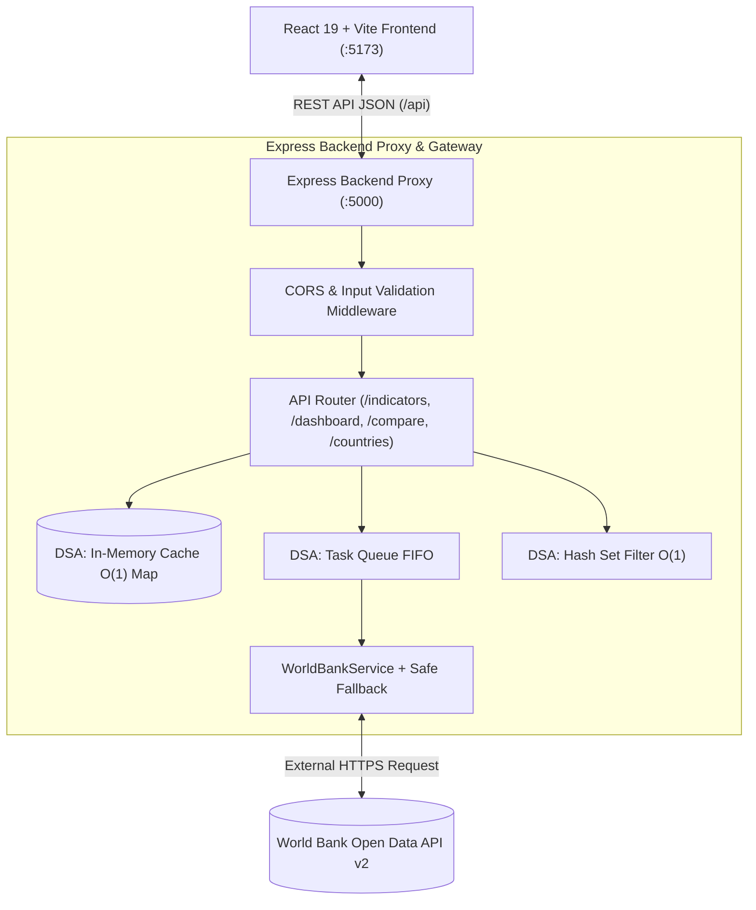

# 🌐 ZoneZet Version 2

### ตารางส่วนร่วม

| ชื่อ-สกุล | รหัสนักศึกษา | ชิ้นงานที่รับผิดชอบ (ไฟล์ / component / route / DSA) | ช่วงที่นำเสนอในคลิป |
|---|:---:|---|:---:|
| **นาย อภิรักษ์ ธรรมแก้ว**<br>*(GitHub: `Apirak001`)* | `681310025` | **Frontend, UX/UI & Frontend DSA Lead:**<br>• `frontend/src/App.jsx`<br>• `frontend/src/components/Navbar.jsx`<br>• `frontend/src/components/Footer.jsx`<br>• `frontend/src/components/LandingAboutView.jsx`<br>• `frontend/src/components/TeamShowcase.jsx`<br>• `frontend/src/components/DashboardHome.jsx`<br>• `frontend/src/components/MetricCard.jsx`<br>• `frontend/src/components/IndicatorView.jsx`<br>• `frontend/src/components/ComparisonHub.jsx`<br>• `frontend/src/components/RunningBarLabel.jsx`<br>• `frontend/src/components/AnimatedValue.jsx`<br>• `frontend/src/components/FeedbackStates.jsx`<br>• `frontend/src/components/UndoToast.jsx`<br>• **DSA (React):** `frontend/src/utils/dsa/mergeSort.js` (Merge Sort $O(n \log n)$), `frontend/src/utils/dsa/undoStack.js` (Stack LIFO $O(1)$) | **ช่วงที่ 1, 2, 3**<br>(0:00 – 3:30)<br>• ช่วง 1: เปิดคลิป แนะนำตัว และตารางส่วนร่วม<br>• ช่วง 2: Before → After เปรียบเทียบกับงานแรก<br>• ช่วง 3: Demo ระบบจริง & Comparison Hub |
| **นาย อนุพงค์ พลจันทึก**<br>*(GitHub: `conankxng`)* | `681310024` | **Backend Express, API Gateway & Backend DSA Lead:**<br>• `backend/server.js`<br>• `backend/routes/indicatorRoutes.js` (`/api/indicators`, `/api/dashboard/summary`, `/api/dashboard/regional-benchmark`, `/api/countries`, `/api/cache/stats`)<br>• `backend/routes/comparisonRoutes.js` (`/api/compare/countries`)<br>• `backend/services/worldBankService.js`<br>• `backend/utils/validation.js` (Input Validation Middleware)<br>• `backend/test-backend.js` (Automated Verification Suite)<br>• `frontend/src/services/api.js` (SWR Client Cache & Deduplication)<br>• `frontend/src/components/SystemHealthView.jsx`<br>• **DSA (Express):** `backend/utils/dsaCache.js` (In-Memory Hash Map Cache $O(1)$), `backend/utils/dsaQueue.js` (Task Queue FIFO), Hash Set Aggregates Filter O(1) | **ช่วงที่ 4, 5, 6**<br>(3:30 – 7:00)<br>• ช่วง 4: เบื้องหลังระบบ (Architecture & Express Gateway)<br>• ช่วง 5: DSA เชิงลึก (Big-O, Verification Test & Cache)<br>• ช่วง 6: สรุปผล สิ่งที่ได้เรียนรู้ และข้อจำกัด |

---

### ตารางข้อแนะนำจากงานแรก → สิ่งที่แก้

| ข้อแนะนำจากงานแรก | สิ่งที่แก้ในงานนี้ | หลักฐาน Before / After |
|---|---|---|
| **1. "อยากให้ดูง่ายกว่านี้ มี UX/UI ที่ดีกว่านี้"** | ปรับสถาปัตยกรรมเป็น **Modern Macroeconomic Intelligence Portal** ด้วย React 19 + Vite แยก Navbar / Content / Footer ชัดเจน รวมทุกโมดูลไว้ใน SPA เดียว สลับดูตัวชี้วัดได้ทันทีโดยไม่ต้องโหลดหน้าใหม่ พร้อมตัวกรองภูมิภาคและรอบปี ค.ศ. (2020–2025) | **Before:** แยกไฟล์ HTML โดดๆ (`gdp.html`, `inflation.html`, `unemployment.html`) ดีไซน์ตารางแบบเรียบ ไม่มี Visual Hierarchy และต้องโหลดหน้าใหม่ทุกครั้ง<br>**After:** จัด Layout แบบเว็บวิเคราะห์เศรษฐกิจสากล (`LandingAboutView` + `DashboardHome` + `IndicatorView` + `ComparisonHub`) สลับแท็บได้ทันทีด้วย React State & Code Splitting พร้อมการ์ดสรุป KPI และตัวเลขวิ่ง (`AnimatedValue`) |
| **2. "อยากให้มีกราฟ"** | พัฒนา Interactive Data Visualization ด้วย **Recharts** ทั้ง Bar Chart จัดอันดับในหน้าภาพรวม/ตัวชี้วัด (พร้อมตัวเลขวิ่งบนแท่งกราฟ `RunningBarLabel`) และกราฟเปรียบเทียบ 4 รูปแบบ (Bar / Line / Area / 5-Axis Radar) ย้อนหลัง 5 ปี (2020–2025) | **Before:** มีเพียงภาพนิ่งใน Carousel สไลด์ ไม่สามารถตอบสนองหรือแสดงข้อมูลจริงตามฟิลเตอร์ได้<br>**After:** กราฟ SVG แบบ Dynamic อัปเดตพร้อมแอนิเมชันสมูทตามฟิลเตอร์ปีและภูมิภาค มี Glassmorphism Tooltip แสดงธงชาติและตัวเลขจริง |
| **3. "ชูเรื่องฟีเจอร์การเปรียบเทียบและให้ใช้งานได้จริง"** | สร้าง **Comparison Hub (ศูนย์เปรียบเทียบเศรษฐกิจโลก)** ที่ผู้ใช้เลือกประเทศได้สูงสุด 4 ประเทศมาวางเทียบกันแบบ Head-to-Head ทั้งการจัดอันดับอัตโนมัติ (ระบุว่าตัวชี้วัดใดยิ่งสูงยิ่งดี หรือยิ่งต่ำยิ่งดี), กราฟแนวโน้ม 5 ปี และตารางเปรียบเทียบพร้อมมงกุฎชี้ผู้นำในแต่ละดัชนี | **Before:** มีเพียง Modal เปรียบเทียบแบบง่ายใน V.1 ซึ่งเปรียบเทียบได้จำกัดและดูยาก<br>**After:** ศูนย์เปรียบเทียบเต็มรูปแบบ 3 ขั้นตอนที่เข้าใจง่าย ค้นหาประเทศพร้อมธงชาติ สลับดูกราฟแท่ง/เส้น/พื้นที่/เรดาร์ และคลิกไฮไลต์รายประเทศได้ทันที |
| **4. "สถานะการทำงาน (Feedback) และ Forgiveness"** | เพิ่มสถานะการทำงานครบ 4 มิติ: **Loading** (`LoadingSkeleton`), **Empty** (`EmptyState`), **Error** (`ErrorBanner` + Safe Fallback), **Success** และระบบ **Undo Stack (LIFO)** กู้คืนประเทศที่เผลอลบ พร้อมแถบเวลา Progress Bar | **Before:** หากยิง API ไม่สำเร็จหน้าจอจะค้าง หากลบประเทศที่เลือกไว้ต้องกดค้นหาใหม่ ไม่มี Feedback แจ้งผู้ใช้<br>**After:** มี Loading Skeleton จำลองโครงร่าง, Error Banner พร้อมปุ่ม Retry และแถบแจ้งเตือน `UndoToast` พร้อมปุ่มกู้คืน (Rollback) ทันทีในคลิกเดียว |

---

## 🏗️ สถาปัตยกรรมระบบ (System Architecture & Component Tree)



### Component Tree (Frontend React + Vite)

```
App.jsx (Root State: activeTab, selectedYear, comparedList, topSummary, indicatorData, cacheStats)
├── CustomCursor.jsx (Luxury Interactive Trailing Cursor)
├── Navbar.jsx (Top Header, Navigation Links with Hover Chunk Preload, Compare Counter Badge)
├── UndoToast.jsx (Floating Notification with Stack LIFO Rollback Button & Auto-Dismiss Progress Bar)
├── Main Content Area (React.lazy + Suspense Code Splitting):
│   ├── LandingAboutView.jsx (หน้าแรก: แนะนำแพลตฟอร์ม, Live Economic Preview Card, Value Props)
│   │   └── TeamShowcase.jsx (ข้อมูลทีมผู้พัฒนา 2 คนและหน้าที่รับผิดชอบ)
│   ├── DashboardHome.jsx (หน้าภาพรวมแดชบอร์ดเศรษฐกิจมหภาค)
│   │   ├── YearSelectorDropdown (เลือกรอบปี ค.ศ. 2020–2025)
│   │   ├── MetricCard.jsx × 3 (GDP TOP 5, Inflation TOP 5, Unemployment TOP 5)
│   │   ├── Recharts 3-Indicator Matrix BarChart + RunningBarLabel.jsx
│   │   └── Regional Macro Benchmark (การ์ดสรุปและกราฟเปรียบเทียบ 7 ทวีปทั่วโลก)
│   ├── IndicatorView.jsx (หน้าสถิติรายตัวชี้วัด: GDP / Inflation / Unemployment)
│   │   ├── Dynamic KPI Cards × 4 (ผู้นำอันดับ 1, ค่าเฉลี่ยโลก, สัดส่วนเสถียรภาพ, จำนวนประเทศ)
│   │   ├── Recharts Top 10 / Bottom 10 BarChart + RunningBarLabel.jsx
│   │   ├── RegionFilterPills (กรองตามภูมิภาค O(1) Pre-computed Counts)
│   │   ├── Search & Sort Toolbar (useDeferredValue Search + MergeSort O(n log n))
│   │   └── Responsive Country Data Table (182 Sovereign Nations + Pagination)
│   ├── ComparisonHub.jsx (ศูนย์เปรียบเทียบเศรษฐกิจพหุภาคี สูงสุด 4 ประเทศ)
│   │   ├── CountryPicker & Search Dropdown (O(1) Set/Map Lookup)
│   │   ├── MetricSelector Cards (GDP Growth, เงินเฟ้อ, อัตราการว่างงาน)
│   │   ├── Direction-Aware Ranking Bars (จัดอันดับพร้อมแถบสีเขียว/แดงเทียบปีก่อนหน้า)
│   │   ├── Multi-Mode Trend Chart (Bar / Line / Area / 5-Pillar RadarChart)
│   │   └── Side-by-Side Comparison Matrix Table (ไฮไลต์ประเทศที่ดีที่สุดในแต่ละตัวชี้วัด)
│   ├── SystemHealthView.jsx (หน้าตรวจสอบสถานะ Backend, Cache Hit Rate & Latency)
│   └── FeedbackStates.jsx (คอมโพเนนต์สถานะ: LoadingSkeleton, EmptyState, ErrorBanner)
└── Footer.jsx (Universal Footer & Circular Scroll-Progress Back-to-Top Button)
```

## ⚡การประยุกต์ใช้โครงสร้างข้อมูลและอัลกอริทึม

| โครงสร้าง / อัลกอริทึม | ตำแหน่งการใช้งาน | หน้าที่ต่อ UX / เหตุผลที่เลือก | การวิเคราะห์เชิงลึก (Big-O & เปรียบเทียบ) |
|---|:---:|---|---|
| **1. Merge Sort** | **React Frontend**<br>(`frontend/src/utils/dsa/mergeSort.js`) | จัดเรียงข้อมูล 182 ประเทศในตารางตามค่าสถิติ (มาก➔น้อย, น้อย➔มาก) หรือตามชื่อประเทศ (A–Z, Z–A) ผู้ใช้กดเรียงแล้วตารางสลับทันทีโดยไม่ค้าง | **อัปเกรดจาก V.1:** เดิมใช้ Bubble Sort ที่มี Time Complexity เป็น $O(n^2)$ ข้อมูล ~200 ประเทศต้องเปรียบเทียบ $\approx 40,000$ ครั้ง<br>เปลี่ยนเป็น Merge Sort (Divide & Conquer) การันตี $O(n \log n)$ ทุกกรณี ($\approx 1,400$ ครั้ง) **เร็วกว่าเดิมกว่า 25 เท่า** และเป็น Stable Sort |
| **2. Stack (LIFO)** | **React Frontend**<br>(`frontend/src/utils/dsa/undoStack.js`) | จัดการระบบ **Undo / Rollback** เมื่อผู้ใช้เผลอกดลบประเทศออกจากชุดเปรียบเทียบ สามารถกดปุ่ม **"กู้คืน (Rollback)"** บนแถบ Toast เพื่อดึงประเทศล่าสุดกลับคืนมาได้ทันที | ทำงานแบบ Last-In, First-Out ด้วยเวลา $O(1)$ ทั้ง `push()` และ `pop()` ตอบสนองหลักจิตวิทยา UX **"Forgiveness"** ป้องกันผู้ใช้เสียข้อมูลที่ตั้งค่าไว้ |
| **3. In-Memory Cache (Hash Map)** | **Express Backend**<br>(`backend/utils/dsaCache.js`)<br>& **React API Service**<br>(`frontend/src/services/api.js`) | แคชผลลัพธ์การเรียก API ของ World Bank ไว้ในหน่วยความจำ เมื่อมีผู้ใช้เรียกซ้ำหรือสลับแท็บไปมาจะคืนค่าทันทีโดยไม่ต้องรอยิงออกต่างประเทศซ้ำ | Key-Value Lookup มี Time Complexity เป็น $O(1)$ ลดภาระเน็ตเวิร์กจาก 1,000–1,500ms เหลือ **< 0.15ms** |
| **4. Hash Set & Index Map ($O(1)$)** | **Express Backend**<br>(`backend/services/worldBankService.js`)<br>& **React Frontend**<br>(`ComparisonHub.jsx`) | ฝั่ง Backend ใช้ `Set` กรองกลุ่มทวีป/องค์กร (`World`, `Euro Area`) ออกจากรายชื่อประเทศ และฝั่ง React ใช้ `Map` / `Set` ค้นหาโปรไฟล์ประเทศในหน้าเปรียบเทียบ | ตรวจสอบด้วย `Set.has(code)` และ `Map.get(code)` ในเวลา $O(1)$ แทนการใช้ `Array.includes()` หรือ `Array.find()` ที่เป็น $O(n)$ |
| **5. Task Queue (FIFO)** | **Express Backend**<br>(`backend/utils/dsaQueue.js`) | ควบคุมคิวงานการดึงข้อมูลตัวชี้วัดหลายชุดต่อเนื่องกันตามลำดับก่อน-หลัง | ทำงานแบบ First-In, First-Out ($O(1)$ enqueue) ช่วยจัดระเบียบลำดับคำขอและป้องกันสภาวะ Race Condition |

---

## 🎨 การจัดการสภาวะการทำงานครบ 4 มิติ

* 🔄 **Loading State:** แสดง `LoadingSkeleton` เป็นแถบ Shimmer Animation จำลองโครงสร้างข้อมูล พร้อม `PageTransitionLoader` ทำให้ผู้ใช้ทราบว่าระบบกำลังทำงาน
* 🔍 **Empty State:** แสดง `EmptyState` เมื่อไม่พบผลลัพธ์จากการค้นหาหรือเมื่อล้างรายชื่อประเทศในหน้าเปรียบเทียบจนว่าง พร้อมคำแนะนำขั้นตอนถัดไปที่ชัดเจน
* ⚠️ **Error State:** แสดง `ErrorBanner` แจ้งเตือนเมื่อการเชื่อมต่อมีปัญหา พร้อมปุ่ม *"ลองใหม่อีกครั้ง (Retry)"* และระบบสลับใช้ข้อมูลสำรอง Offline Fallback อัตโนมัติโดยหน้าเว็บไม่ล่ม
* ✅ **Success State:** แสดงการ์ดสรุปสถิติ แบดจ์สถานะ กราฟ Recharts พร้อมตัวเลขวิ่ง (`RunningBarLabel`) และตารางเปรียบเทียบอย่างสมบูรณ์

---

## 🚀 ขั้นตอนการติดตั้งและรันโปรเจกต์ (How to Run)

### ติดตั้ง Dependencies
```bash
# ติดตั้ง Backend
cd backend
npm install

# ติดตั้ง Frontend
cd ../frontend
npm install
```

### การเปิดเซิร์ฟเวอร์สำหรับ Demo
เปิด Terminal 2 หน้าต่าง:

```bash
# Terminal ที่ 1: รัน Backend API
cd backend
npm run dev
# เซิร์ฟเวอร์เปิดที่: http://localhost:5000
# ทดสอบ Health: http://localhost:5000/api/health
# ทดสอบ Automated Verification Suite (5/5 Checks): npm test
```

```bash
# Terminal ที่ 2: รัน Frontend React + Vite
cd frontend
npm run dev
# เข้าใช้งานเว็บที่: http://localhost:5173
```

---

