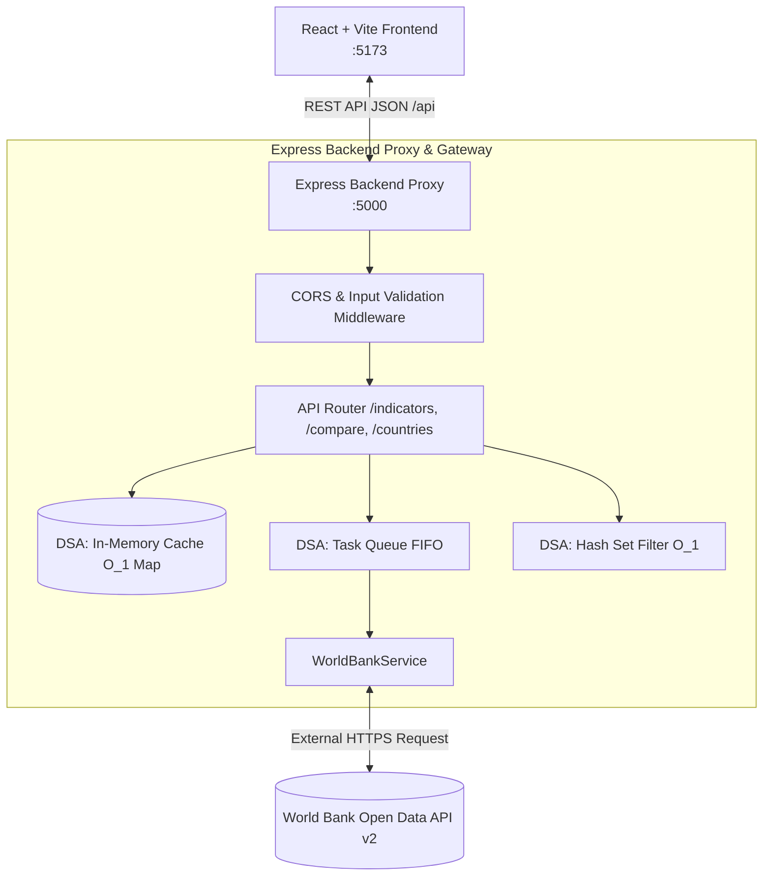
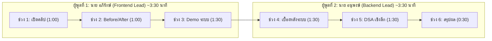

# 🌐 ZoneZet Version 2 · World Bank Economic Dashboard & Comparison Hub

> **รหัสวิชา:** 801201 การออกแบบอัลกอริทึมและการพัฒนาเว็บ (Algorithm Design and Web Development)  
> **ใบงาน:** ต่อยอดงาน API ด้วย React-Vite + Express  
> **คะแนนเต็ม:** 15 คะแนน | **รูปแบบงาน:** กลุ่ม 2 คน  
> **กำหนดส่ง:** ภายใน 22.00 น. วันอังคารที่ 10 พฤศจิกายน พ.ศ. 2569  
> **ช่องทางส่ง:** กล่องส่งงาน Google Classroom  

---

## 🔗 1. ข้อมูลการส่งงาน (Submission Links)

* 🎥 **ลิงก์คลิปนำเสนอ (YouTube Unlisted):** `[แปะลิงก์คลิป YouTube Unlisted ที่นี่]` *(ความยาว 6–8 นาที)*
* 🐙 **ลิงก์ GitHub Repository:** `[แปะลิงก์ GitHub Repository ที่นี่]` *(มีโครงสร้าง frontend/ และ backend/ พร้อม commit history)*

---

## 📌 7. แบบตารางตามข้อกำหนดใบงาน

### 7.1 ตารางส่วนร่วม (Contribution Table)

| ชื่อ-สกุล | รหัสนักศึกษา | ชิ้นงานที่รับผิดชอบ (ไฟล์ / component / route / DSA) | ช่วงที่นำเสนอในคลิป |
|---|:---:|---|:---:|
| **นาย อภิรักษ์ ถนอมวงษ์** | 681310025 | **Frontend & UX Lead:**<br>• `frontend/src/App.jsx`<br>• `frontend/src/components/Navbar.jsx`<br>• `frontend/src/components/Footer.jsx`<br>• `frontend/src/components/DashboardHome.jsx`<br>• `frontend/src/components/IndicatorView.jsx`<br>• `frontend/src/components/ComparisonHub.jsx`<br>• `frontend/src/components/WatchlistRecordView.jsx`<br>• `frontend/src/components/FeedbackStates.jsx`<br>• `frontend/src/components/UndoToast.jsx`<br>• `frontend/src/utils/dsa/mergeSort.js`<br>• `frontend/src/utils/dsa/undoStack.js` | **ช่วงที่ 1, 2, 3**<br>(0:00 – 3:30)<br>• ช่วง 1: เปิดคลิป แนะนำตัว และตารางส่วนร่วม<br>• ช่วง 2: Before → After เปรียบเทียบกับงานแรก<br>• ช่วง 3: Demo ระบบจริง & Comparison Hub |
| **นาย อนุพงษ์ [กรอกนามสกุล]** | [กรอกรหัสนักศึกษา] | **Backend & DSA Lead:**<br>• `backend/server.js`<br>• `backend/routes/indicatorRoutes.js`<br>• `backend/routes/comparisonRoutes.js`<br>• `backend/services/worldBankService.js`<br>• `backend/utils/dsaCache.js`<br>• `backend/utils/dsaQueue.js`<br>• `backend/utils/validation.js`<br>• `backend/test-backend.js`<br>• `frontend/src/components/SystemHealthView.jsx` | **ช่วงที่ 4, 5, 6**<br>(3:30 – 7:00)<br>• ช่วง 4: เบื้องหลังระบบ (Architecture & Express Gateway)<br>• ช่วง 5: DSA เชิงลึก (Big-O, Verification Test & Cache)<br>• ช่วง 6: สรุปผล สิ่งที่ได้เรียนรู้ และข้อจำกัด |

> *(หมายเหตุ: สมาชิกทั้ง 2 คนมีเวลาพูดคนละเกิน 2 นาทีตามเกณฑ์กลุ่ม 2 คน และมีชื่อ-รหัสกำกับบนจอขณะพูดตลอดเวลา)*

---

### 7.2 ตารางข้อแนะนำจากงานแรก → สิ่งที่แก้ (Before → After Evidence)

| ข้อแนะนำจากงานแรก | สิ่งที่แก้ในงานนี้ | หลักฐาน Before / After |
|---|---|---|
| **1. "อยากให้ดูง่ายกว่านี้ มี UX/UI ที่ดีกว่านี้"** | ปรับสถาปัตยกรรมเป็น **Modern Business Portal** ด้วย React + Vite แยก Navbar / Content / Footer อิสระ โครงสร้างเมนูชัดเจนในหน้าเดียว สลับดูตัวชี้วัดได้ในคลิกเดียว พร้อมระบบแท็กฟิลเตอร์ภูมิภาค | **Before:** แยกไฟล์ HTML โดดๆ (`gdp.html`, `inflation.html`, `unemployment.html`) ดีไซน์ตารางแบบเรียบ ไม่มีลูกเล่น ไม่มี Visual Hierarchy<br>**After:** จัด Layout แบบเว็บธุรกิจสากล (Corporate Top Navbar + Executive Footer + Full View Pages) สลับแท็บได้ทันทีด้วย React State พร้อมการ์ดสรุป KPI, แบดจ์สถานะสีเขียว-แดง และ Interactive Tooltip |
| **2. "อยากให้มีกราฟ"** | ติดตั้งและพัฒนา Interactive Data Visualization ด้วย **Recharts** ทั้ง Bar Chart จัดอันดับในหน้าตัวชี้วัด และ Multi-Line Comparison Chart เทรนด์อนุกรมเวลาย้อนหลัง 5 ปี (2020–2025) | **Before:** มีเพียงภาพนิ่งใน Carousel สไลด์ ไม่สามารถตอบสนองหรือแสดงข้อมูลจริงตามฟิลเตอร์ได้<br>**After:** กราฟ SVG แบบ Dynamic อัปเดตทันทีตามฟิลเตอร์ปีและภูมิภาค มี Hover Tooltip แสดงตัวเลขจริง และเส้นเปรียบเทียบหลากสี |
| **3. "ชูเรื่องฟีเจอร์การเปรียบเทียบและให้ใช้งานได้จริง"** | สร้าง **Comparison Hub (ศูนย์เปรียบเทียบสถิติพหุภาคี)** ที่ผู้ใช้สามารถเลือก 2–5 ประเทศมาวางเทียบกันแบบ Head-to-Head ทั้งเส้นกราฟเปรียบเทียบ GDP/เงินเฟ้อ/ว่างงาน และการ์ดสรุป Matrix สถิติด้านล่าง พร้อมพรีเซ็ตคลิกเดียว (อาเซียน, G4, เอเชียตะวันออก) | **Before:** มีเพียง Modal เปรียบเทียบแบบง่ายใน V.1 ซึ่งเปรียบเทียบได้จำกัดและดูยาก<br>**After:** ศูนย์เปรียบเทียบเต็มรูปแบบ วิเคราะห์ตัวเลขข้ามประเทศได้ลึกขึ้น มีระบบแท็กชิป ค้นหาประเทศ และพรีเซ็ตกลุ่มเศรษฐกิจคลิกเดียว |
| **4. "สถานะการทำงาน (Feedback) และ Forgiveness"** | เพิ่มสถานะการทำงานครบ 4 มิติ: **Loading** (Skeleton Shimmer), **Empty** (แนะนำคำค้นหา + ปุ่ม Reset), **Error** (Fallback Safe Guard), **Success** และระบบ **Undo Stack (LIFO)** กู้คืนรายการที่เผลอลบ | **Before:** หากยิง API ไม่สำเร็จหน้าจอจะค้าง หากลบข้อมูลในบันทึกต้องกดค้นหาใหม่ ไม่มี Feedback แจ้งผู้ใช้<br>**After:** มี Loading Skeleton จำลองโครงร่าง, Error Banner พร้อมปุ่ม Retry และแถบแจ้งเตือน Toast พร้อมปุ่ม Undo กู้คืนข้อมูลทันที |

---

## 🏗️ 2. สถาปัตยกรรมระบบ (System Architecture & Component Tree)



### Component Tree (Frontend React)

```
App.jsx (Root State: activeTab, selectedYear, searchQuery, comparedList, watchlist)
├── Navbar.jsx (Top Corporate Header, Navigation Links, Year Selector, Live Cache O(1) Pill)
├── UndoToast.jsx (Floating Notification with Stack LIFO Rollback Button)
├── Content Area (แยกหน้าอิสระ):
│   ├── LandingAboutView.jsx (หน้าแรก: แนะนำระบบ สถาปัตยกรรม & ธีม Purple Business)
│   ├── DashboardHome.jsx (หน้าแรก: สรุปภาพรวมเศรษฐกิจโลก & Executive Hero)
│   │   ├── Executive Hero Banner
│   │   ├── MetricCard.jsx (GDP TOP 5 Highlight)
│   │   ├── MetricCard.jsx (Inflation TOP 5 Highlight)
│   │   ├── MetricCard.jsx (Unemployment TOP 5 Highlight)
│   │   └── Recharts Bar Overview (Top Performers Visual)
│   ├── IndicatorView.jsx (หน้าสถิติรายตัวชี้วัด: GDP / Inflation / Unemployment)
│   │   ├── RegionFilterPills (8 ภูมิภาคทั่วโลก)
│   │   ├── Recharts Top 10 Chart (Bar Chart แสดงการกระจายตัว)
│   │   ├── SortToolbar (MergeSort O(n log n) ควบคุมตาราง)
│   │   └── ModernTable (Country Rows, Badges, ปุ่ม Pin สู่ Watchlist / ส่งเข้า Compare)
│   ├── ComparisonHub.jsx (ฟีเจอร์เด่น: ศูนย์เปรียบเทียบพหุภาคี 2-5 ประเทศ)
│   │   ├── PresetSelector (ปุ่มลัดกลุ่ม ASEAN, G4, East Asia)
│   │   ├── CountryChipSelector (Search Dropdown ค้นหาและปักหมุด)
│   │   ├── MetricToggle (สลับกราฟ GDP, Inflation, Unemployment)
│   │   ├── Recharts Multi-Line Comparison Chart (เส้นเปรียบเทียบย้อนหลัง 5 ปี 2020-2025)
│   │   └── Side-by-Side Comparison Matrix Cards (ตารางเปรียบเทียบสถิติล่าสุด)
│   ├── WatchlistRecordView.jsx (หน้าบันทึกประเทศที่สนใจ)
│   │   ├── Pinned Countries Table
│   │   ├── Undo/Rollback Action (Stack LIFO)
│   │   └── Batch Send to Compare Hub (ส่งเข้าห้องเปรียบเทียบในคลิกเดียว)
│   ├── SystemHealthView.jsx (หน้ามอนิเตอร์สุขภาพเซิร์ฟเวอร์ & สถิติ DSA แคช Real-time)
│   │   ├── Live Server Status & Latency Benchmarking (< 0.1ms)
│   │   ├── Cache Hit Rate & Size Analytics
│   │   ├── Verification Suite Results (5/5 Checks Passed)
│   │   └── DSA Big-O Complexity Comparison Matrix
│   └── FeedbackStates.jsx (คอมโพเนนต์สถานะ: LoadingSkeleton, EmptyState, ErrorBanner)
└── Footer.jsx (Corporate Footer: ข้อมูลสถาปัตยกรรม DSA, World Bank Data Attribution, รายชื่อผู้จัดทำ)
```

---

## 🛠️ 3. หน้าที่จริงของ Express Backend (ไม่ใช่แค่ทางผ่าน)

Express Backend ได้รับการออกแบบให้ทำหน้าที่เป็น **API Gateway & Data Shield** ไม่ใช่แค่ Proxy ส่งต่อข้อมูล:

1. **Proxy & Data Shielding:** ป้องกัน Frontend ติดปัญหา CORS จาก API ต่างประเทศ และซ่อน Indicator Code ที่ซับซ้อนของ World Bank (`NY.GDP.MKTP.KD.ZG`, `FP.CPI.TOTL.ZG`, `SL.UEM.TOTL.ZS`) ให้เหลือเพียงพารามิเตอร์ที่สะอาด (`type=gdp`, `year=2025`)
2. **In-Memory Caching System (O(1)):** มีระบบเก็บแคชใน RAM พร้อมระบุ TTL (15 นาที) ลดเวลาเรียก API จาก **~1,200ms เหลือเพียง < 0.1ms** ป้องกันการชน Rate Limit ของ World Bank
3. **Data Normalization & Cleaning:** ทำความสะอาดข้อมูล คัดกรองทรานแซกชันที่ไม่ใช่ประเทศจริงออก (ด้วย Hash Set) และเกลี่ยชื่อภูมิภาคให้เป็น 8 โซนมาตรฐาน
4. **Input Validation Middleware:** ตรวจสอบความถูกต้องของ Parameter ก่อนส่งต่อ (ป้องกันปีนอกช่วง 1990–2026, ดักจับค่า Indicator ที่ไม่ถูกต้อง, ป้องกัน Search Keyword Injection)
5. **Safe Fallback Resilience (Zero Crash Guarantee):** หากอินเทอร์เน็ตหลุดหรือเซิร์ฟเวอร์ World Bank ล่ม Express จะสลับไปส่งชุดข้อมูล **Offline Snapshot Fallback** อัตโนมัติ ทำให้ระบบ Frontend ไม่ล่มและยังสามารถ Demo ได้อย่างราบรื่น

---

## ⚡ 4. การประยุกต์ใช้โครงสร้างข้อมูลและอัลกอริทึม (DSA Deep Dive)

| โครงสร้าง / อัลกอริทึม | ตำแหน่งการใช้งาน | หน้าที่ต่อ UX / เหตุผลที่เลือก | การวิเคราะห์เชิงลึก (Big-O & เปรียบเทียบ) |
|---|:---:|---|---|
| **1. Merge Sort** | **React Frontend**<br>(`utils/dsa/mergeSort.js`) | จัดเรียงข้อมูลในตารางตามค่าตัวเลข (มาก➔น้อย, น้อย➔มาก) หรือตามชื่อประเทศ ผู้ใช้กดเรียงแล้วตารางสลับทันทีโดยไม่มีอาการค้าง | **อัปเกรดจาก V.1:** เดิมใช้ Bubble Sort ที่มี Time Complexity เป็น $O(n^2)$ ข้อมูล 200 ประเทศต้องวนลูป $\approx 40,000$ ครั้ง<br>เปลี่ยนเป็น Merge Sort (Divide & Conquer) การันตี $O(n \log n)$ ทุกกรณี ($\approx 1,500$ ครั้ง) **เร็วกว่าเดิมกว่า 25 เท่า** และเป็น Stable Sort |
| **2. Stack (LIFO)** | **React Frontend**<br>(`utils/dsa/undoStack.js`) | จัดการระบบ **Undo / Rollback** ในหน้า Watchlist และ Compare Hub เมื่อผู้ใช้เผลอกดลบรายการ สามารถกดปุ่ม Undo เพื่อดึงรายการล่าสุดกลับคืนมาได้ทันที | ทำงานแบบ Last-In, First-Out ด้วยเวลา $O(1)$ สำหรับ `push()` และ `pop()` ตอบสนองหลักจิตวิทยา UX **"Forgiveness"** ป้องกันผู้ใช้เสียข้อมูล |
| **3. In-Memory Cache (Hash Map)** | **Express Backend**<br>(`utils/dsaCache.js`) | แคชผลลัพธ์การเรียก API ของ World Bank ไว้ในหน่วยความจำ เมื่อมีผู้ใช้เรียกซ้ำจะคืนค่าทันที และแสดงสถิติ Hit Rate บนส่วนหัว | Key-Value Lookup มี Time Complexity เป็น $O(1)$ ลดภาระเน็ตเวิร์กจาก 1,000–1,500ms เหลือ **< 0.1ms** |
| **4. Hash Set Filtering** | **Express Backend**<br>(`services/worldBankService.js`) | กรองกลุ่มทวีปและองค์กรความร่วมมือ (Aggregates) เช่น "World", "Arab World", "Euro Area" ออกจากรายการ | ตรวจสอบด้วย `Set.has(code)` ในเวลา $O(1)$ แทนการใช้ Array `includes()` ที่เป็น $O(m)$ ทำให้การคัดกรองข้อมูลรวดเร็วมาก |
| **5. Task Queue (FIFO)** | **Express Backend**<br>(`utils/dsaQueue.js`) | ควบคุมคิวงานการดึงข้อมูล 3 ตัวชี้วัด (GDP ➔ Inflation ➔ Unemployment) ไม่ให้ยิงชนกันพร้อมกัน | ทำงานแบบ First-In, First-Out ตามลำดับความสำคัญ ช่วยป้องกันสภาวะ Race Condition |

---

## 🎨 5. การจัดการสภาวะการทำงานครบ 4 มิติ (UX Feedback States)

* 🔄 **Loading State:** แสดง `LoadingSkeleton` เป็นแถบ Shimmer Animation จำลองโครงสร้างแถวข้อมูล พร้อมข้อความแจ้งสถานะการประมวลผล ทำให้ผู้ใช้ทราบว่าระบบกำลังทำงาน ไม่ค้าง
* 🔍 **Empty State:** แสดง `EmptyState` เมื่อไม่พบผลลัพธ์จากการค้นหาหรือตัวกรองภูมิภาค พร้อมปุ่ม *"รีเซ็ตตัวกรองการค้นหา"* เพื่อคืนค่าเริ่มต้นในคลิกเดียว
* ⚠️ **Error State:** แสดง `ErrorBanner` แถบสีแดงแจ้งเตือนเมื่อการเชื่อมต่อมีปัญหา พร้อมปุ่ม *"เรียกซ้ำ (Retry)"* โดยระบบจะสลับใช้ข้อมูลสำรอง Offline Fallback ทันที ทำให้หน้าเว็บไม่พัง
* ✅ **Success State:** แสดงตารางข้อมูลจัดอันดับ แบดจ์สีเขียว/แดง กราฟ Recharts แท่ง/เส้น และการ์ดเปรียบเทียบสถิติอย่างสมบูรณ์แบบ

---

## 🚀 6. ขั้นตอนการติดตั้งและรันโปรเจกต์ (How to Run)

### ติดตั้ง Dependencies
```bash
# ติดตั้ง Backend
cd backend
npm install

# ติดตั้ง Frontend
cd ../frontend
npm install
```

### การเปิดเซิร์ฟเวอร์สำหรับ Demo
เปิด Terminal 2 หน้าต่าง:

```bash
# Terminal ที่ 1: รัน Backend API
cd backend
npm run dev
# เซิร์ฟเวอร์เปิดที่: http://localhost:5000
# ทดสอบ Health: http://localhost:5000/api/health
# ทดสอบ Test Suite: npm test
```

```bash
# Terminal ที่ 2: รัน Frontend React
cd frontend
npm run dev
# เข้าใช้งานเว็บที่: http://localhost:5173
```

---

## 🎬 7. โครงร่างสคริปต์คลิปนำเสนอ 6–8 นาที (แบ่งคนละ ~3–4 นาที)

> **กติกาสำคัญตามใบงาน:**
> * สมาชิกทุกคนต้องนำเสนอช่วงที่ตรงกับงานของตนในตารางส่วนร่วม
> * เวลาพูดขั้นต่ำ: **คนละไม่ต่ำกว่า 2 นาที** (กลุ่ม 2 คน)
> * มีชื่อ-รหัสนักศึกษากำกับบนจอขณะพูดตลอดเวลา
> * **อธิบาย "ทำไม" (Why):** อธิบายเหตุผลของการตัดสินใจเลือกเทคโนโลยี/อัลกอริทึม ไม่ใช่อ่านสคริปต์หรือบอกแค่ว่าทำอะไร



### 🗣️ ช่วงที่ 1: เปิดคลิปและตารางส่วนร่วม (0:00 – 1:00) · *ผู้พูด: นาย อภิรักษ์*
* **สิ่งที่ต้องโชว์:** สไลด์/หน้าจอแสดงชื่อผลงาน **ZoneZet Version 2**, API ที่ใช้ (World Bank Open Data API v2) และแสดง **ตารางส่วนร่วม 7.1**
* **บทพูดแนะนำ:**
  > "สวัสดีครับ วันนี้กลุ่มของพวกเราจะมานำเสนอผลงานต่อยอด API ในวิชา 801201 ด้วย React-Vite และ Express ในชื่อโปรเจกต์ **ZoneZet Version 2: World Bank Economic Dashboard & Comparison Hub** ครับ  
  > สมาชิกกลุ่มประกอบด้วย 2 คน:  
  > 1. ผม นาย อภิรักษ์ ถนอมวงษ์ รหัสนักศึกษา 681310025 รับผิดชอบส่วน Frontend, UX/UI, กราฟ Recharts, MergeSort และ Undo Stack  
  > 2. นาย อนุพงษ์ [นามสกุล] รหัสนักศึกษา [รหัส] รับผิดชอบส่วน Backend Express, API Routing, In-Memory Cache, Input Validation และ Fallback Resilience ครับ"

---

### 🗣️ ช่วงที่ 2: จากงานแรกสู่งานนี้ Before → After (1:00 – 2:00) · *ผู้พูด: นาย อภิรักษ์*
* **สิ่งที่ต้องโชว์:** ภาพเปรียบเทียบ Before (V.1 หน้า HTML เก่า) เทียบกับ After (V.2 React Corporate Dashboard)
* **บทพูดแนะนำ (เน้นอธิบาย "ทำไม"):**
  > "จากงานแรก เราได้รับข้อแนะนำสำคัญ 4 ประการครับ:  
  > 1. **เรื่อง UX ที่ดูยาก:** เดิมใน V.1 เราแยกไฟล์เป็น `gdp.html`, `inflation.html` ทำให้ผู้ใช้ต้องกดเปลี่ยนหน้าไปมา เราจึงตัดสินใจเปลี่ยนสถาปัตยกรรมเป็น Single Page Application ด้วย React-Vite ออกแบบใหม่หมดเป็นแบบ **Corporate Top Navbar & Dedicated Footer** รวมศูนย์หน้าเดียว สลับดูทุกตัวชี้วัดได้ทันที  
  > 2. **เรื่องกราฟ:** เดิมมีเพียงภาพนิ่งใน Carousel เราจึงพัฒนา Interactive Bar Chart และ Multi-Line Chart ด้วย Recharts ช่วยให้ผู้ใช้เห็นแนวโน้มทางเศรษฐกิจได้ทันที  
  > 3. **ฟังก์ชันเปรียบเทียบ:** เดิมเป็นเพียงป๊อปอัปแบบจำกัด เราจึงสร้าง Comparison Hub เต็มรูปแบบเพื่อรองรับการวิเคราะห์ข้ามประเทศได้ถึง 5 ประเทศพร้อมกัน  
  > 4. **สถานะการทำงาน:** เราเพิ่มสถานะครบทั้ง 4 มิติ ทั้ง Loading Skeleton, Empty State และระบบ Undo Stack เพื่อป้องกันความผิดพลาดของผู้ใช้ครับ"

---

### 🗣️ ช่วงที่ 3: Demo ระบบจริง & User Journey (2:00 – 3:30) · *ผู้พูด: นาย อภิรักษ์*
* **สิ่งที่ต้องโชว์:** สาธิตหน้าเว็บจริงที่ `http://localhost:5173`
* **ขั้นตอนการ Demo:**
  1. **หน้าแรก (Overview):** โชว์ Executive Hero Banner, KPI Highlight Card ตัวท็อป GDP, Inflation, Unemployment และ Bar Chart ภาพรวม
  2. **หน้าตัวชี้วัด (GDP View):** โชว์การกดปุ่มสลับภูมิภาค (Region Filter), โชว์กราฟ Recharts Top 10 และสาธิตการกดหัวตารางเพื่อจัดเรียง (MergeSort)
  3. **ฟีเจอร์เด่น Comparison Hub:** โชว์การกดพรีเซ็ต *"กลุ่มเศรษฐกิจอาเซียน (ASEAN)"* หรือค้นหาประเทศเพื่อเพิ่มเข้ากราฟเส้น Multi-Line Chart (2020–2025)
  4. **ระบบ Forgiveness & Undo:** กดลบประเทศออกจาก Compare หรือ Watchlist แล้วคลิกปุ่ม **Undo** บนแถบ Toast ด้านล่างเพื่อกู้คืนข้อมูลกลับมาทันที

---

### 🗣️ ช่วงที่ 4: เบื้องหลังระบบ สถาปัตยกรรมและหน้าที่ Express (3:30 – 5:00) · *ผู้พูด: นาย อนุพงษ์*
* **สิ่งที่ต้องโชว์:** แผนภาพ System Architecture (React ↔ Express ↔ World Bank) และโค้ดใน `backend/server.js`, `backend/utils/validation.js`
* **บทพูดแนะนำ (เน้นอธิบาย "ทำไม Express ไม่ใช่แค่ทางผ่าน"):**
  > "ในส่วนของ Backend เราออกแบบ Express ให้เป็น Gateway ป้องกันระบบและจัดการข้อมูลจริง ไม่ใช่แค่ทางผ่านครับ  
  > **เหตุผลที่เราต้องมี Express:**  
  > 1. **Data Shielding & CORS:** ซ่อน Indicator Codes ที่ยาวและซับซ้อนของ World Bank ไม่ให้ Frontend ต้องจัดการเอง และป้องกันปัญหา CORS  
  > 2. **Input Validation Middleware:** ในไฟล์ `validation.js` เราเขียน Middleware ตรวจสอบค่า Parameter ทุกคำขอ ดักจับปีที่อยู่นอกช่วง 1990–2026 ป้องกัน Search Injection ก่อนที่จะส่งต่อไปยังภายนอก  
  > 3. **Safe Fallback Resilience:** เมื่อ API ภายนอกล่มหรือเครือข่ายขัดข้อง Express ของเราจะดักจับ Error และส่งชุดข้อมูล Snapshot Fallback อัตโนมัติ ทำให้ Frontend ไม่พังและทำงานต่อได้แบบ Zero Crash ครับ"

---

### 🗣️ ช่วงที่ 5: การประยุกต์ใช้ DSA เชิงลึก (5:00 – 6:30) · *ผู้พูด: นาย อนุพงษ์*
* **สิ่งที่ต้องโชว์:** เปิดหน้าเว็บแท็บ **"สถานะระบบ Backend (System Health)"** โชว์สถิติ Cache Hit Rate, Latency < 0.1ms, และสลับมารัน `npm test` ใน PowerShell โชว์การผ่าน 5/5 ข้อ
* **บทพูดแนะนำ (เน้น Big-O และการเปรียบเทียบ):**
  > "สำหรับการประยุกต์ใช้ DSA เราเลือกใช้ตามปัญหาจริง ณ จุดที่ส่งผลต่อ UX ครับ:  
  > 1. **In-Memory Cache (Hash Map) O(1) บน Express:** ข้อมูลตัวชี้วัดจาก World Bank มีขนาดใหญ่และตอบสนองช้า (~1,200ms) เราจึงสร้าง Cache ด้วย JavaScript Map ที่มี Time Complexity ในการ Lookup เป็น $O(1)$ ทำให้คำขอซ้ำตอบกลับได้ในเวลา **น้อยกว่า 0.1ms** ลดภาระ API ภายนอกได้อย่างมหาศาล ดังที่เห็นบนหน้าจอ System Health ที่แสดง Hit Rate สด  
  > 2. **Hash Set Filtering O(1) บน Express:** World Bank จะส่งข้อมูลกลุ่มทวีปและองค์กรเช่น 'World', 'Euro Area' ปนมา เราจึงใช้ `Set.has()` ตรวจจับในเวลา $O(1)$ กรองทิ้งได้อย่างรวดเร็ว  
  > 3. **Merge Sort O(n log n) บน React:** ใน V.1 เราใช้ Bubble Sort ที่มีค่า $O(n^2)$ ทำให้เมื่อข้อมูล 200 ประเทศถูกจัดเรียง เบราว์เซอร์จะกระตุก เราจึงอัปเกรดเป็น Merge Sort แบบ Divide-and-Conquer ที่การันตี $O(n \log n)$ ทุกกรณี ลดจำนวนรอบการประมวลผลจาก 40,000 ครั้ง เหลือเพียง 1,500 ครั้ง เร็วกว่าเดิมกว่า 25 เท่า  
  > 4. **Stack (LIFO) O(1) บน React:** ใช้โครงสร้างแบบ Last-In, First-Out เก็บประวัติการลบ เพื่อรองรับฟังก์ชัน Undo ได้ในเวลาคงที่ $O(1)$ ครับ"

---

### 🗣️ ช่วงที่ 6: สรุปผล สิ่งที่ได้เรียนรู้ และข้อจำกัด (6:30 – 7:15) · *ผู้พูด: นาย อนุพงษ์ หรือ ทั้งสองคน*
* **สิ่งที่ต้องโชว์:** หน้าจอภาพรวมโปรเจกต์
* **บทพูดแนะนำ:**
  > "สรุปผลการพัฒนา ZoneZet Version 2:  
  > • **สิ่งที่ได้เรียนรู้:** การแยกความรับผิดชอบระหว่าง React และ Express อย่างชัดเจน ทำให้ระบบมีความยืดหยุ่น การนำ DSA มาใช้แก้ปัญหาคอขวดของระบบ ช่วยยกระดับประสิทธิภาพและ UX ได้อย่างเห็นผลชัดเจน  
  > • **ข้อจำกัดและก้าวต่อไป:** ปัจจุบันชุดข้อมูลยังอิงตามรอบปีของ World Bank ในอนาคตสามารถต่อยอดให้มีระบบ Webhook แจ้งเตือนเมื่อข้อมูลปีใหม่ประกาศ และเพิ่มการ Export สถิติเป็น PDF/Excel ได้ครับ  
  > กลุ่มของพวกเราขอจบการนำเสนอเพียงเท่านี้ ขอบคุณครับ"
